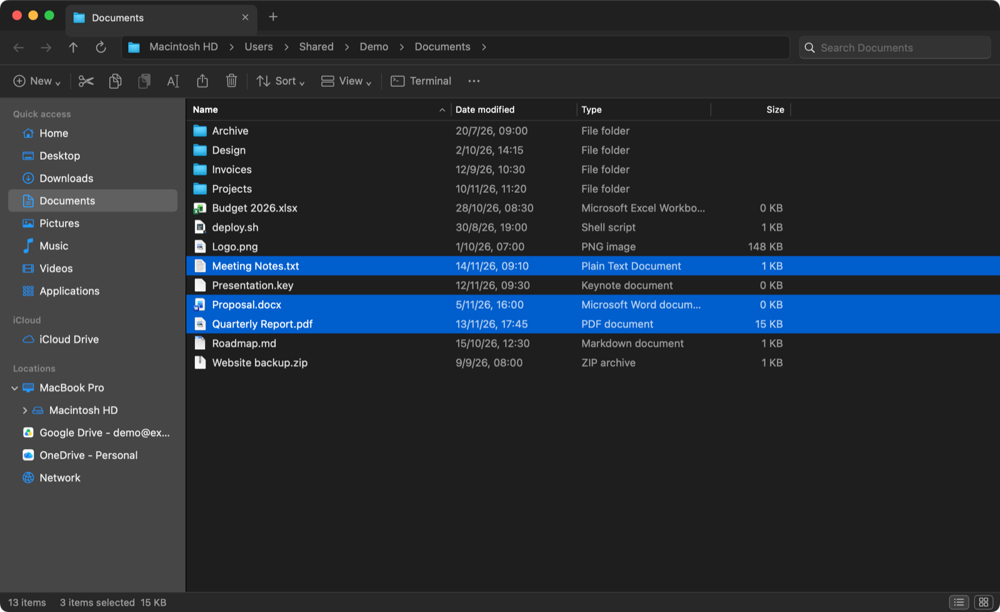
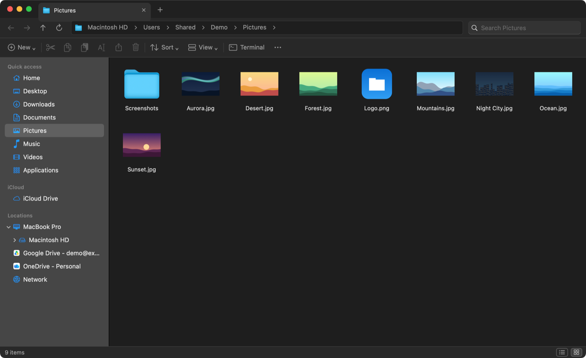
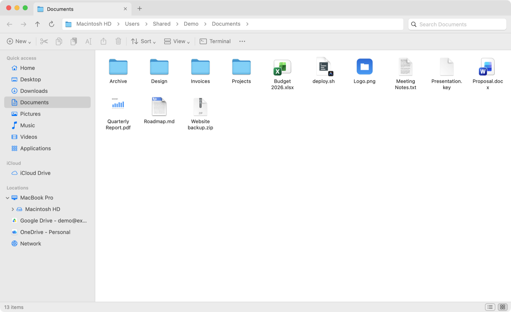

# ViFinder

[](https://github.com/viennv96/vi-finder/actions/workflows/build.yml)


**A Windows 11 File Explorer style file manager for macOS 14+.** Native Swift/AppKit: tabs in the title bar, breadcrumb address bar, cut/copy/paste, Details & icon views, right-click *Open in Terminal*, Windows keyboard shortcuts.

Trình quản lý file cho macOS 14+ với giao diện và thao tác giống **Windows 11 File Explorer**.
Viết bằng Swift + AppKit (native, không Electron), build bằng Swift Package Manager, **không cần Xcode**, chỉ cần Command Line Tools.



<table>
  <tr>
    <td></td>
    <td></td>
  </tr>
  <tr>
    <td align="center">Large icons (thumbnail ảnh, video, PDF)</td>
    <td align="center">Medium icons, giao diện sáng</td>
  </tr>
</table>

## Tải về

- **Bản phát hành:** trang [Releases](https://github.com/viennv96/vi-finder/releases) → tải `ViFinder.dmg` (hoặc `ViFinder.zip`).
- **Bản mới nhất từ `main`:** tab [Actions](https://github.com/viennv96/vi-finder/actions/workflows/build.yml) → chọn lần build gần nhất → artifact **ViFinder**.

Một file chạy được trên cả Apple Silicon và Intel (universal binary).

> App chỉ được ký ad-hoc (chưa notarize với Apple), nên lần đầu mở macOS sẽ chặn. Mở **System Settings → Privacy & Security**, kéo xuống và bấm **Open Anyway**.
> Hoặc chạy: `xattr -dr com.apple.quarantine /Applications/ViFinder.app`

## Build từ source

Cần macOS 14+ và Command Line Tools (`xcode-select --install`), Swift 5.9 trở lên.

```bash
make run        # build (kiến trúc máy hiện tại) → build/ViFinder.app và mở app
make install    # build rồi copy vào /Applications
make universal  # build universal (arm64 + x86_64)
make package    # universal + đóng gói build/ViFinder.dmg và build/ViFinder.zip
make clean
```

Hoặc `scripts/build-app.sh [debug|release] [native|universal]`. Khi dev nhanh: `swift build`.

> Lần đầu mở Desktop/Documents/Downloads, macOS sẽ hỏi quyền truy cập, bấm Allow.
> Sau mỗi lần build lại, macOS có thể hỏi lại quyền (do chữ ký ad-hoc thay đổi).

## Phát hành phiên bản mới

GitHub Actions ([build.yml](.github/workflows/build.yml)) build universal ở mỗi lần push/PR. Đẩy một tag `v*` để tạo Release kèm `ViFinder.dmg` và `ViFinder.zip`:

```bash
git tag v1.0.0
git push origin v1.0.0
```

Số phiên bản trong app lấy theo tag (`v1.0.0` → `1.0.0`).

## Đặt làm trình quản lý file mặc định

1. `make install` (để app nằm cố định trong /Applications), rồi mở ViFinder từ /Applications.
2. Menu **ViFinder → Set ViFinder as Default File Browser…**. Muốn trả lại: cùng menu đó → **Restore Finder as Default File Browser**.

Mục này làm 2 việc:
- Đặt ViFinder là app mặc định cho thư mục (`public.folder`): `open .` trong Terminal và các app khác mở thư mục → ViFinder.
- Ghi `NSFileViewer` (giống `defaults write -g NSFileViewer com.vifinder.app`): các app hỗ trợ sẽ dùng ViFinder cho "Show in Finder". Đây là mẹo cộng đồng, không có tài liệu chính thức từ Apple, nên một số app vẫn mở Finder.

macOS không cho thay hẳn Finder: Desktop, Dock, Thùng rác và các thư mục mở từ bên trong Finder vẫn là Finder. "Show in Finder" bên trong ViFinder luôn mở Finder thật.

## Tính năng

| Windows Explorer | ViFinder |
|---|---|
| Tab trên thanh tiêu đề | Tab tự vẽ trên title bar: `+`, ×, middle-click để đóng, menu chuột phải (Duplicate, Move to new window, Close others…) |
| Thanh địa chỉ breadcrumb | Bấm từng đoạn để nhảy tới, bấm `›` để chọn thư mục con, `«` khi đường dẫn quá dài, bấm vào khoảng trống để gõ đường dẫn (hỗ trợ `~`, đường dẫn tương đối, `file://`, URL web). Gõ `cmd` / `terminal` để mở Terminal tại thư mục hiện tại |
| Ô Search | Lọc ngay khi gõ trong thư mục hiện tại |
| Command bar | New ▾, Cut, Copy, Paste, Rename, Share, Delete, Sort ▾, View ▾, Terminal, ⋯ |
| Navigation pane | Quick access, iCloud Drive, tên máy Mac (giống *This PC*) chứa các ổ đĩa dạng cây, OneDrive / Google Drive / Dropbox (`~/Library/CloudStorage`), Network (Connect to Server – SMB/AFP/NFS) |
| View | Details (Name / Date modified / Type / Size, bấm header để sort, kéo đổi cột), Large icons, Medium icons (có thumbnail) |
| Status bar | Số item, số item đang chọn + dung lượng, tiến trình copy/move, nút chuyển view |
| Chuột phải trên file/thư mục | Open, Open in new tab/window, Open with ▸, **Open in Terminal**, Open in ▸ (iTerm, Warp, Ghostty, VS Code, Cursor…), Cut, Copy, Paste into folder, Copy as path, Rename, Delete, Delete permanently, Compress to ZIP, Extract All, Share, Show in Finder, Properties |
| Chuột phải vào khoảng trống | View ▸, Sort by ▸, Refresh, Paste, New ▸ (Folder, Text Document), Open in Terminal, Properties |
| Copy / Cut / Paste | Dùng clipboard hệ thống → copy từ ViFinder dán sang Finder và ngược lại. File đã Cut hiện mờ. Trùng tên: Replace / Skip / Keep both. Dán vào cùng thư mục → `name - Copy.ext` |
| Kéo thả | Cùng ổ = move, khác ổ = copy, giữ ⌥ = copy, giữ ⌘ = move. Thả được lên thư mục trong danh sách hoặc trong Navigation pane |
| Khác | Tự refresh khi thư mục thay đổi, Quick Look (Space), Properties (tính dung lượng thư mục), hiện/ẩn file ẩn và đuôi file, nút back/forward trên chuột |

## Phím tắt

Trên Mac, phím ⌘ thay cho Ctrl. Các tổ hợp Ctrl kiểu Windows (Ctrl+C/X/V/A, Ctrl+Shift+N, Ctrl+T/W/L/F/E…) cũng dùng được.

| Thao tác | Phím |
|---|---|
| Chọn dải (từ item đã chọn tới item được click) | Shift+click, Shift+mũi tên |
| Chọn thêm / bỏ chọn từng item | ⌘+click (Shift+⌘+click: thêm cả dải vào vùng đang chọn) |
| Copy / Cut / Paste | ⌘C / ⌘X / ⌘V |
| Copy as path | ⌥⌘C (Ctrl+Shift+C) |
| Mở | Enter, ⌘O, ⌘↓, double-click |
| Rename | F2 |
| Delete (vào Thùng rác) | Del (fn+⌫), ⌘⌫ |
| Xóa vĩnh viễn | ⇧⌫, ⇧Del, ⌥⌘⌫ |
| Properties | ⌘I, ⌥Enter |
| New folder / New text document | ⇧⌘N / ⌥⌘N |
| Open in Terminal | ⌥⌘T |
| Back / Forward / Up | ⌫ (Backspace), ⌥← / ⌥→ / ⌥↑, ⌘[ / ⌘] / ⌘↑, nút chuột 4/5 |
| Refresh | F5, ⌘R |
| Thanh địa chỉ | ⌘L, ⌥D, ⇧⌘G |
| Search | ⌘F, Ctrl+E |
| Tab mới / Đóng tab / Đổi tab | ⌘T / ⌘W / Ctrl+Tab, ⇧⌘] ⇧⌘[ |
| Cửa sổ mới | ⌘N |
| Large icons / Medium icons / Details | ⌘1 / ⌘2 / ⌘3 |
| Hiện file ẩn | ⇧⌘. |
| Quick Look | Space |
| Connect to Server | ⌘K |

> Như Windows, ⌫ (Backspace) là **Back**. Trên bàn phím Mac không có phím Delete riêng, dùng **⌘⌫** hoặc **fn+⌫** để xóa file.

## Cấu trúc code

```
Sources/ViFinder/
  App/        main.swift, AppDelegate, MainMenu (menu bar)
  Model/      FileItem, BrowserModel (điều hướng + listing của mỗi tab), Preferences
  Services/   FileOperations (copy/move/xóa/zip), FileClipboard, TerminalLauncher, DefaultFileBrowser,
              DirectoryMonitor (kqueue), IconProvider (icon + thumbnail)
  UI/         ExplorerWindowController (cửa sổ + tab), TabStrip, ExplorerViewController (+Actions, +Menus),
              AddressBar, CommandBar (+StatusBar), PropertiesWindowController
  UI/Files/   DetailsViewController (NSTableView), IconsViewController (NSCollectionView)
  UI/Sidebar/ SidebarViewController (Navigation pane)
  Util/       Places (thư mục chuẩn; VIFINDER_DEMO_HOME để chụp ảnh demo), Extensions
scripts/      build-app.sh (native / universal), package.sh (dmg + zip), make-icon.swift
Support/      Info.plist, AppIcon.icns
.github/      workflows/build.yml (CI build universal + Release)
```

## Giới hạn hiện tại

- Không thể thay hẳn Finder (xem mục "Đặt làm trình quản lý file mặc định").
- Chưa có: Undo (⌘Z) cho thao tác file, tìm kiếm đệ quy trong thư mục con, view List/Tiles/Content, preview pane, mục "Shared" của iCloud, Tags.
